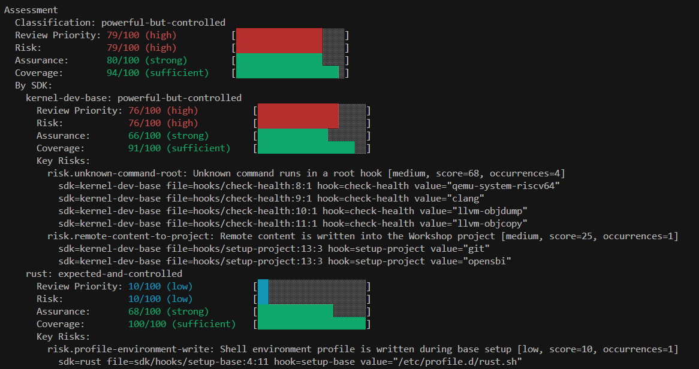
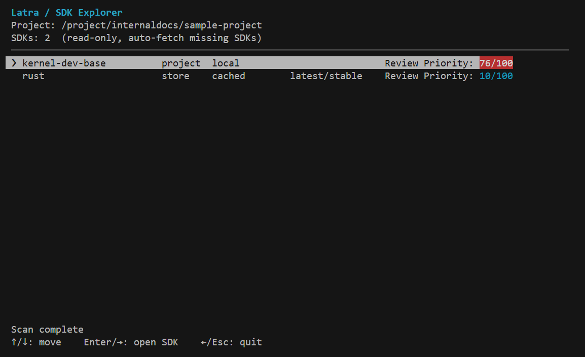
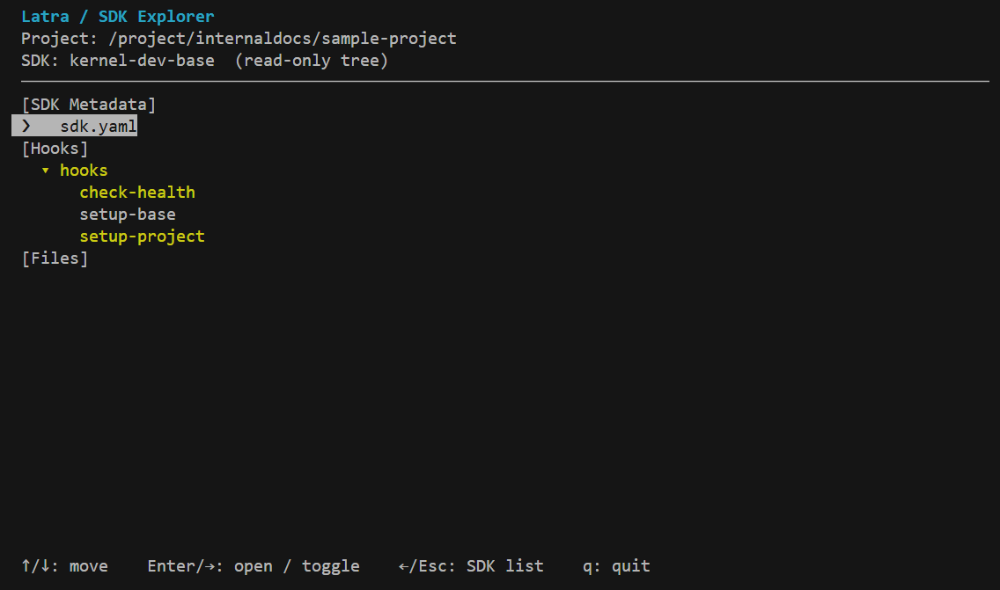
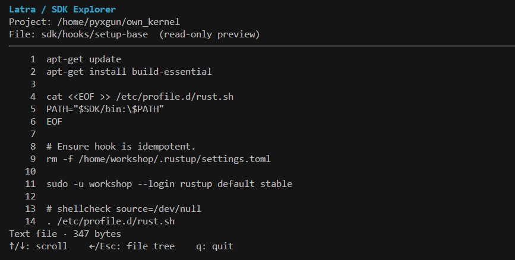

<p>
  
</p>

# Latra

Latra is an open-source static analysis tool for [Canonical Workshop](https://ubuntu.com/workshop) SDKs. It is designed to reveal SDK contents and behavior that are otherwise difficult to inspect before a Workshop environment is created.

Workshop SDKs can include shell hooks that run during environment setup, health checks, and refresh operations. Because SDKs may come from third-party publishers, Latra treats every SDK as untrusted input and analyzes it without executing its hooks.

Latra aims to provide:

- an inventory of SDK metadata, bundled files, and lifecycle hooks;
- Bash syntax analysis based on an abstract syntax tree rather than text matching;
- normalized commands, file and network interactions, data flows, and capabilities;
- evidence-backed risk and assurance findings with explainable SDK assessments;
- deterministic, versioned JSON output for local tooling and CI integration;
- support for in-project SDKs followed by SDK Store resolution and analysis.

Latra reports review priority, risk, assurance, and static-analysis coverage independently. These assessments support review decisions; they do not declare an SDK safe or malicious.

## Screenshots

1. Scan and Assesment (CLI Operation)

<p>
  
</p>

2. Explorer (TUI Operation)

<p>
  
</p>

<p>
  
</p>

<p>
  
</p>

## Quick Start

### Build and install

Build Latra inside the Workshop environment and install the resulting binary
on the host:

```bash
./scripts/install.sh
```

### TUI Operation

Latra provides an interactive TUI to help you inspect and investigate SDKs.  
Launch it from your Workshop project root.

```bash
latra explorer
```

The Explorer opens with the Workshop list and automatically retrieves and scans the SDKs. Select a Workshop to inspect its SDKs and configuration, or press `s` to open the SDK list. Once scanning is complete, each SDK's Review Priority appears in the SDK list.

```text
 Latra / SDK Explorer
 Project: /project/internaldocs/sample-project
 SDKs: 2  (read-only, auto-fetch missing SDKs)
 ────────────────────────────────────────────────────────────────────────────────────────────────────
 ❯ kernel-dev-base          project  local                          Review Priority: 68/100
   rust                     store    cached        latest/stable    Review Priority: 25/100
```

To verify the scan results and examine the actual SDK contents, select an SDK using Enter or the right arrow key (→).
The Explorer displays the SDK's **Metadata**, **Hooks**, and **Files**.

```text
 Latra / SDK Explorer
 Project: /project/internaldocs/sample-project
 SDK: kernel-dev-base  (read-only tree)
 ────────────────────────────────────────────────────────────────────────────────────────────────────
 [SDK Metadata]
     sdk.yaml
 [Hooks]
   ▾ hooks
       check-health
       setup-base
 ❯     setup-project
 [Files]
```

You can inspect any file, but a good starting point is to focus on the highlighted files.  
Files flagged by Latra for further review include inline Risk or Semantic Gap annotations that identify the relevant source lines and explain why they were flagged.

```text
 Latra / SDK Explorer
 Project: /project/internaldocs/sample-project
 File: hooks/setup-project  (read-only preview)
 ────────────────────────────────────────────────────────────────────────────────────────────────────
     1  #!/usr/bin/env bash
     2  set -euxo pipefail
     3  
     4  # clone and build opensbi
     5  OPENSBI_VERSION="v1.9"
     6  OPENSBI_URL="https://github.com/riscv-software-src/opensbi.git"
     7  
     8  echo "[*] OpenSBI version: ${OPENSBI_VERSION}"
     9  echo "[*] OpenSBI url: ${OPENSBI_URL}"
    10  
    11  # clone opensbi from github
    12  if [ ! -d opensbi ]; then
 #Risk > Remote content is written into the Workshop project, medium, score=25/100
    13    git clone \
    14      --depth=1 \
    15      --branch="${OPENSBI_VERSION}" \
    16      --single-branch \
    17      "${OPENSBI_URL}" \
    18      opensbi
    19  fi
    20  
    21  # build firmware
```


### CLI Operation
You can also scan and inspect SDKs directly from the command line.  
Run the following command from your Workshop project root.

```bash
latra scan
```

The default text report shows input, Workshop definitions, and Assessment. Use `latra scan --verbose` for the SDK inventory, interfaces, observations, and diagnostics.

#### Review the assessment

Each scan ends with an assessment that separates detected risk, positive
assurance, general analysis coverage, and semantic coverage:

```text
Assessment
  Classification: requires-semantic-review
  Review Priority: 72/100 (high)          [██████████████░░░░░░]
  Risk:            72/100 (high)          [██████████████░░░░░░]
  Assurance:       80/100 (strong)        [████████████████░░░░]
  Coverage:        75/100 (insufficient)  [███████████████░░░░░]
  Semantic:        75/100 (insufficient)  [███████████████░░░░░]
    Semantic gap [included-sources/external-include]: source at rust/sdk/hooks/setup-base is not a statically resolvable SDK-local include
  By SDK:
    kernel-dev-base: powerful-but-controlled
      Review Priority: 68/100 (high)          [██████████████░░░░░░]
      Risk:            68/100 (high)          [██████████████░░░░░░]
      Assurance:       66/100 (strong)        [█████████████░░░░░░░]
      Coverage:        93/100 (sufficient)    [███████████████████░]
      Semantic:        100/100 (sufficient)   [████████████████████]
      Key Risks:
        risk.unknown-command-root: Unknown command runs in a root hook [medium, score=58, occurrences=3]
          sdk=kernel-dev-base file=hooks/check-health:8:1 hook=check-health value="qemu-system-riscv64"
          sdk=kernel-dev-base file=hooks/check-health:10:1 hook=check-health value="llvm-objdump"
          sdk=kernel-dev-base file=hooks/check-health:11:1 hook=check-health value="llvm-objcopy"
        risk.remote-content-to-project: Remote content is written into the Workshop project [medium, score=25, occurrences=1]
          sdk=kernel-dev-base file=hooks/setup-project:13:3 hook=setup-project value="git"
          sdk=kernel-dev-base file=hooks/setup-project:13:3 hook=setup-project value="opensbi"
    rust: requires-semantic-review
      Review Priority: 25/100 (medium)        [█████░░░░░░░░░░░░░░░]
      Risk:            10/100 (low)           [██░░░░░░░░░░░░░░░░░░]
      Assurance:       68/100 (strong)        [██████████████░░░░░░]
      Coverage:        75/100 (insufficient)  [███████████████░░░░░]
      Semantic:        75/100 (insufficient)  [███████████████░░░░░]
        Semantic gap [included-sources/external-include]: source at rust/sdk/hooks/setup-base is not a statically resolvable SDK-local include
      Key Risks:
        risk.profile-environment-write: Shell environment profile is written during base setup [low, score=10, occurrences=1]
          sdk=rust file=sdk/hooks/setup-base:4:11 hook=setup-base value="/etc/profile.d/rust.sh"

Diagnostics
  rust: [warning] external-include (include): source at rust/sdk/hooks/setup-base is not a statically resolvable SDK-local include
```

This result indicates that the project SDK requires focused review because it
runs resolved but unregistered commands as root and writes remotely obtained content into the
project. The Rust SDK has one low-risk static environment configuration write,
but its absolute `source` of `/etc/profile.d/rust.sh` cannot currently be
analyzed as an SDK-local include. That semantic gap limits both the Rust SDK and
combined project coverage to 75 and produces the `requires-semantic-review`
classification. These classifications describe the observed behavior, analysis
coverage, and controls; they do not guarantee that either SDK is safe.

The per-SDK `Key Risks` and `Semantic gap` entries identify what needs review
and why. Risk `sdk`, `file`, and `hook` values can be passed directly to the
inspection commands in the next section. In the TUI, semantic gaps backed by an
operation location are attached to the corresponding source line.

#### Inspect a hook or file

Use an SDK name and hook reported by the scan:

```bash
# command: latra hook <sdk> <hook>

latra hook rust setup-base
```

<details>
<summary>Example output</summary>

```text
apt-get update
apt-get install build-essential

cat <<EOF >> /etc/profile.d/rust.sh
PATH="$SDK/bin:\$PATH"
EOF

# Ensure hook is idempotent.
rm -f /home/workshop/.rustup/settings.toml

sudo -u workshop --login rustup default stable

# shellcheck source=/dev/null
. /etc/profile.d/rust.sh
rustup completions bash > /etc/bash_completion.d/rustup.sh
```

</details><br>

Display any detected SDK file by its reported path:

```bash
# command: latra file <sdk> <file>

latra file rust meta/sdk.yaml
```

<details>
<summary>Example output</summary>

```text
name: rust
version: 1.99.1
summary: The Rust toolchain installer
description: |
  This SDK provides rustup and the Rust toolchain for Rust development.
  Toolchains and Cargo configuration are persisted on the host across
  workshop updates. Automatically detects project toolchain requirements
  via rust-toolchain.toml.
base: ubuntu@24.04
architecture: arm64
website: https://github.com/canonical/rust-sdk
license: Apache-2.0 OR MIT
plugs:
  cargo-registry:
    interface: mount
    workshop-target: /home/workshop/.cargo/registry
sdkcraft-started-at: '2026-10-16T19:27:34.158961+00:00'
```

</details><br>

Replace `rust`, `setup-base`, and `meta/sdk.yaml` with values from your project report. Latra resolves the SDK from the current project's `.workshop/*.yaml` definitions, including its declared channel.

#### Write a JSON report

Print the summary as JSON:

```bash
latra scan . --format json
```

Write the complete inventory and analysis details to a file:

```bash
latra scan . --format json --verbose --output latra-report.json
```

### Uninstall

```bash
./scripts/uninstall.sh
```

## User documentation

- [Documentation overview](docs/README.md) — documentation organized by
  audience and purpose.
- [Quick Start](docs/user/quickstart.md) — scan a project, inspect SDK content,
  and write a JSON report.
- [Command reference](docs/user/command-reference.md) — CLI commands, arguments,
  options, exit codes, and environment variables.
- [Understanding scan output](docs/user/report-output.md) — how to read each report
  section and use its SDK, hook, and file values for further investigation.

## Developer documentation

- [Analysis databases](docs/development/database/README.md) — command
  knowledge, capabilities, path semantics, and finding rules.
- [Development environment](docs/development/development.md) — build, test,
  and run Latra in Workshop.

## Contributing

Contributions are welcome. See [CONTRIBUTING.md](CONTRIBUTING.md) and [CODE_OF_CONDUCT.md](CODE_OF_CONDUCT.md) before participating.

## Security

Do not report security vulnerabilities through public issues. See [SECURITY.md](SECURITY.md) for the reporting process.

## License

Latra is licensed under the [MIT License](LICENSE).

## Project status

Latra is under active development and is not yet recommended for production enforcement. The current scope focuses on deterministic SDK inventory generation and investigation workflows.

Latra is an independent project and is not affiliated with or endorsed by Canonical Ltd.
