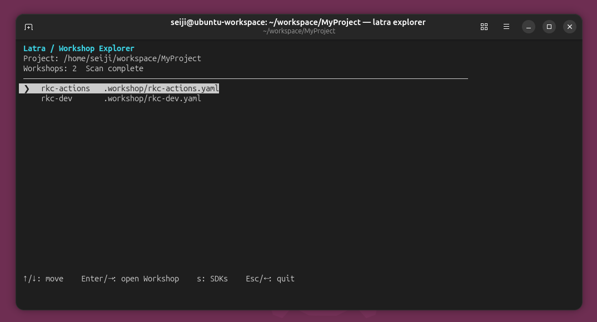
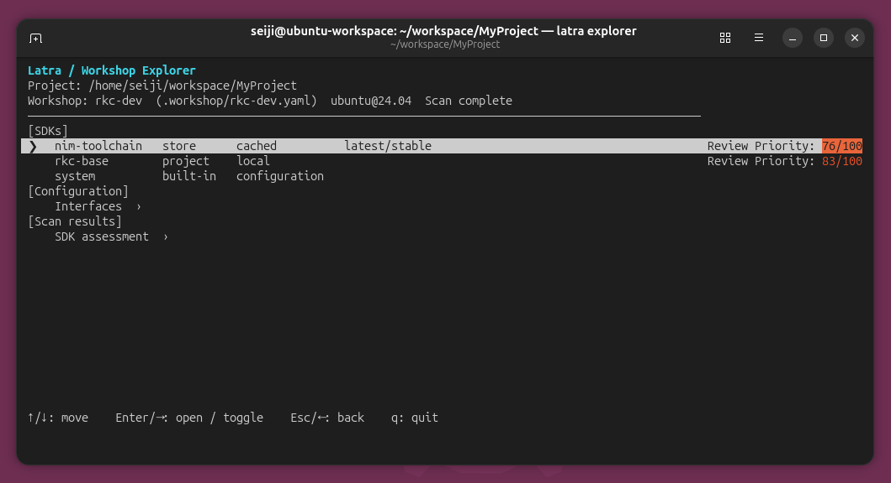
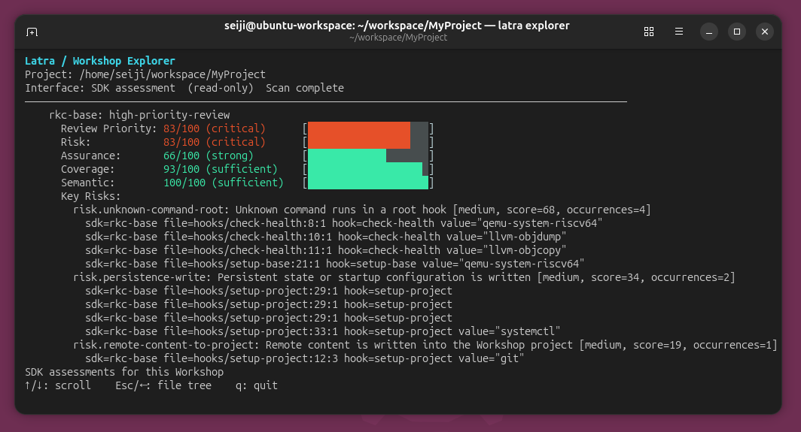
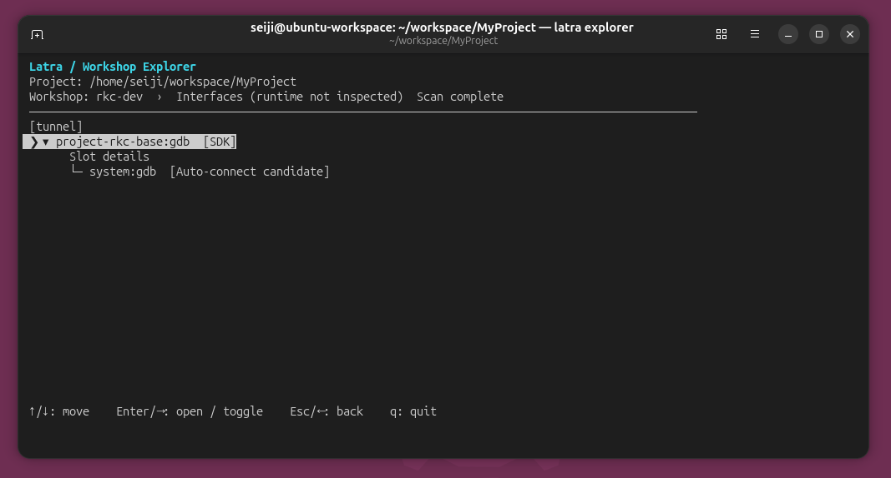
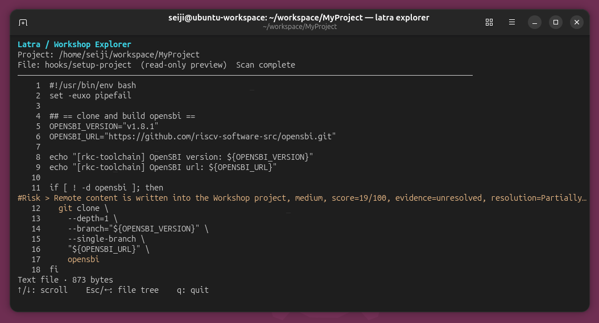
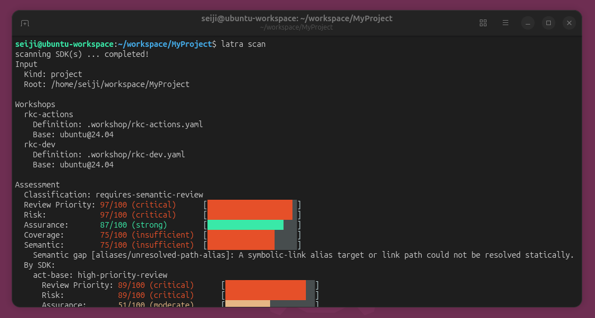

<p>
  
</p>

# Latra

**Explore your Canonical Workshop SDKs before you run them.**

Latra is an open-source static analysis tool for [Canonical Workshop](https://ubuntu.com/workshop). Start with a Workshop, follow its SDKs and interfaces, and inspect the hooks and files behind each finding—all from your terminal.

SDKs can include hooks that run during environment setup, health checks, and refresh operations. Latra inventories and analyzes their contents without executing those hooks, helping you decide what needs a closer look.

## Why Latra?

- **Investigate in context.** Browse from a Workshop to its SDKs, configuration, and per-SDK assessments in the interactive Explorer.
- **Understand interface relationships.** See declared slots and the plugs associated with them, including configured connections and automatic-connection candidates.
- **Follow findings to the source.** Open SDK metadata, hooks, and files; risk and semantic-gap annotations point to relevant lines when a location is available.
- **Review with evidence.** Latra reports review priority, risk, assurance, and analysis coverage separately, with findings and source locations to guide investigation.
- **Use the CLI and JSON too.** Get a concise assessment in the terminal or export detailed results for local tooling and CI.

## What Latra can detect

Latra analyzes SDK hooks for behavior and data flows that may deserve review, including:

- **Sensitive data exposure:** reads of credential-like files, project-sensitive data sent to an external endpoint, and sensitive project data persisted in SDK state.
- **Remote content and execution:** downloaded content executed by a shell or written into the Workshop project.
- **Project changes:** modification or deletion of project files, changes to build or execution controls, and rewritten version-control state.
- **Persistent behavior:** writes to startup or service configuration, and configuration of repository hooks.
- **Privileged or hard-to-analyze behavior:** unknown commands in root hooks, dynamic code execution, unresolved SDKs, and incomplete hook analysis.

**Review priority indicates where to investigate first; it does not mean an SDK is malicious.** Legitimate SDKs may need some of these behaviors. Review the evidence and the SDK's intended purpose in context. Latra performs static analysis without executing hooks, so findings describe detected behavior or potential data flows, not proof that an action occurred. Analysis gaps can also leave behavior undetected.

## Get started

### Install

Build and install from a checkout of this repository. The installer requires Canonical Workshop and builds Latra in the project's development Workshop:

```bash
git clone https://github.com/shizuku198411/Latra.git
cd Latra
./scripts/install.sh
```

By default, the binary is installed to `~/.local/bin`; add that directory to your `PATH` if needed. Set `LATRA_INSTALL_DIR` to choose another installation directory. To remove it, run `./scripts/uninstall.sh` from the checkout, using the same `LATRA_INSTALL_DIR` if you set one.

### Open a Workshop project

From your Workshop project root, run:

```bash
latra explorer
```

Or select a project from elsewhere:

```bash
latra explorer --project /path/to/project
```

Explorer currently requires Linux and an interactive terminal. It opens on the Workshop list, fetches missing Store SDKs when needed, and starts a background scan. Store resolution may require network access; progress or failures are shown in the Explorer. Project SDKs are read locally.

## Explore a Workshop

Use Explorer to investigate the Workshops and SDKs defined in your project. Names, SDK versions, cache status, and scores depend on your project and scan environment.

### 1. Choose a Workshop

Explorer starts with the Workshop definitions in the project. It supports `workshop.yaml` or `.workshop.yaml` at the project root, as well as `.workshop/<name>.yaml` definitions:

<p>
  
</p>

Select a Workshop to see its SDKs, interface configuration, and scan results. When the scan finishes, SDK rows show their review priority where available.

<p>
  
</p>

Open **SDK assessment** for the assessments of SDKs used by this Workshop. The assessment values come from the project scan; the view filters the SDKs shown to those declared by the selected Workshop.

<p>
  
</p>

### 2. Follow interfaces

Open **Configuration → Interfaces** to view declared slots and their associated plugs. Tunnel endpoints are shown when declared:

<p>
  
</p>

Open a row for details. The view uses SDK declarations, Workshop configuration, and connection policy to describe configured relationships and candidates. A candidate is not proof of a connection: Latra does not inspect the running Workshop or its effective runtime exposure.

### 3. Inspect an SDK and its evidence

Open an SDK to browse its metadata, hooks, interfaces, and files. Select a file to read it in a read-only preview. After the scan completes, relevant files and source lines can carry risk or semantic-gap annotations, making it easier to move from an assessment to the code behind it.

<p>
  
</p>

Use `↑` / `↓` to move or scroll, `Enter` / `→` to open or expand, and `Esc` / `←` to go back. Press `q` to quit. From the Workshop list, press `s` to browse the project-wide SDK list instead.

## Scan from the command line

From a Workshop project root:

```bash
latra scan
```

<p>
  
</p>

The assessment separates **review priority**, **risk**, **assurance**, **coverage**, and **semantic coverage**. Per-SDK findings and semantic gaps explain what was detected and where investigation may be needed. These are review aids, not guarantees that an SDK is safe or malicious. A scan can also be incomplete; check its exit status when automating it.

Inspect a hook or file from an SDK declared by the current project:

```bash
latra hook <sdk> <hook>
latra file <sdk> <file>
```

Replace the placeholders with an SDK name, hook name, and file path from your scan results. For Store SDKs, these inspection commands use an SDK already in Latra's cache; run a scan first if needed.

Export a compact JSON summary or a complete report:

```bash
latra scan --format json
latra scan --format json --verbose --output latra-report.json
```

## Documentation

- [Documentation overview](docs/README.md)
- [Quick Start](docs/user/quickstart.md) — scan a project, inspect SDK content, and write a report
- [Command reference](docs/user/command-reference.md) — CLI options, exit codes, and environment variables
- [Understanding scan output](docs/user/report-output.md) — interpret reports and findings
- [Development environment](docs/development/development.md) and [analysis databases](docs/development/database/README.md)

## Project status

Latra is under active development and is not yet recommended for production enforcement. Static analysis has limits: unresolved SDKs, dynamic shell behavior, and incomplete analysis can affect the evidence and coverage reported.

Latra is an independent project and is not affiliated with or endorsed by Canonical Ltd.

## Contributing and security

Contributions are welcome! See [CONTRIBUTING.md](CONTRIBUTING.md) and [CODE_OF_CONDUCT.md](CODE_OF_CONDUCT.md). For security vulnerabilities, follow [SECURITY.md](SECURITY.md) rather than opening a public issue.

## License

Latra is licensed under the [MIT License](LICENSE).
